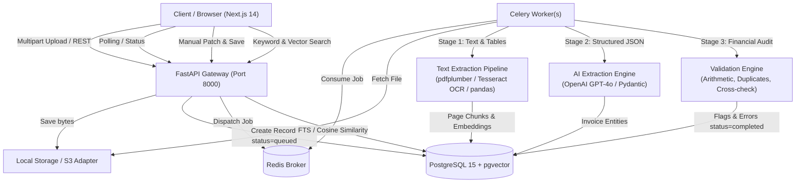

# System Architecture: AI-Powered Document Intelligence

## 1. High-Level Architecture Overview

The system is designed as an asynchronous, event-driven intelligent document processing pipeline. It decouples document ingestion from computationally heavy operations (OCR, PDF page rendering, tabular parsing, and LLM structured extraction) through a distributed task queue backed by Celery and Redis.

---

## 2. Component Breakdown

### 2.1 Next.js 14 Frontend
- **Framework:** Next.js 14 App Router, TypeScript, Tailwind CSS, Lucide icons.
- **Key Modules:**
  - `FileUpload.tsx`: Multi-file drag-and-drop supporting PDF, PNG, JPG, TIFF, XLSX, XLS, CSV.
  - `DocumentTable.tsx`: Live dashboard with status badges and polling updates.
  - `ExtractedDataForm.tsx`: Interactive inline editor for manual human corrections with live re-validation.
  - `ValidationList.tsx`: Visual audit discrepancies categorized by severity (`error`, `warning`).
  - `CrossVerificationModal.tsx`: Cross-document reconciliation (e.g. PDF invoice against Excel ledger).
  - `SearchPage.tsx`: Hybrid search interface toggling between PostgreSQL full-text keyword matching and pgvector semantic embeddings.

### 2.2 FastAPI Backend API
- **Framework:** FastAPI with asynchronous ASGI endpoints.
- **Security:** JWT authentication (`/auth/register`, `/auth/login`, `/auth/me`), bcrypt password hashing, input sanitization, rate limiting (SlowAPI), and CORS protection.
- **Asynchronous Task Dispatch:** Immediately returns HTTP 202 Accepted with a tracking ID and dispatches background processing to Celery workers.
- **Fail-Safe Design:** Operates in distributed Celery mode when Redis is present, and gracefully switches to synchronous eager execution during tests and local single-node development.

### 2.3 Document Processing & OCR Pipeline
- **Format Router:** Detects format via file extension combined with magic byte inspection.
- **Digital PDFs:** Ingested via `pdfplumber` with table boundary extraction.
- **Scanned Documents & Low-DPI Images:** Automatic fallback to `pdf2image` and `pytesseract` with Pillow contrast and sharpening filters.
- **Spreadsheets & CSV:** `pandas` and `openpyxl` extract multi-sheet workbooks into structured markdown-style tabular text.
- **Large Document Scalability (1,000+ Pages):** Iterates page-by-page to prevent `OutOfMemoryError` conditions and stream-stores per-page text into the database.

### 2.4 AI Information Extraction Service
- **Model:** OpenAI GPT-4o with strict JSON mode output validation.
- **Schema Enforcement:** Pydantic models validate `invoice_number`, `invoice_date`, `supplier_name`, `customer_name`, `subtotal`, `tax`, `total`, `currency`, and itemized `line_items`.
- **Hallucination Prevention:** Strict prompt rules mandate setting missing or uncertain fields to `null` rather than generating guesses.
- **Resilience:** Implements exponential backoff with 3 automatic retries on rate limits or network hiccups, paired with a deterministic regex/pattern fallback when offline.

### 2.5 Validation & Cross-Verification Engine
- **Deterministic Math Rules:** Verifies that `subtotal + tax == total` (within ±0.01 tolerance) and `sum(line_items) == subtotal`.
- **Duplicate Prevention:** Checks database indexes for identical invoice numbers from the same supplier.
- **Cross-Verification (PDF-PDF & PDF-Excel):** Reconciles invoice numbers, supplier names, and totals across disparate uploaded documents and produces discrepancy reports.

### 2.6 Persistence & Semantic Vector Search
- **Primary Relational Store:** PostgreSQL 15 storing documents, structured schemas, validation logs, and audit trails.
- **Semantic Retrieval:** OpenAI `text-embedding-3-small` generates 1536-dimensional embeddings for extracted text chunks, enabling cosine similarity semantic retrieval.
