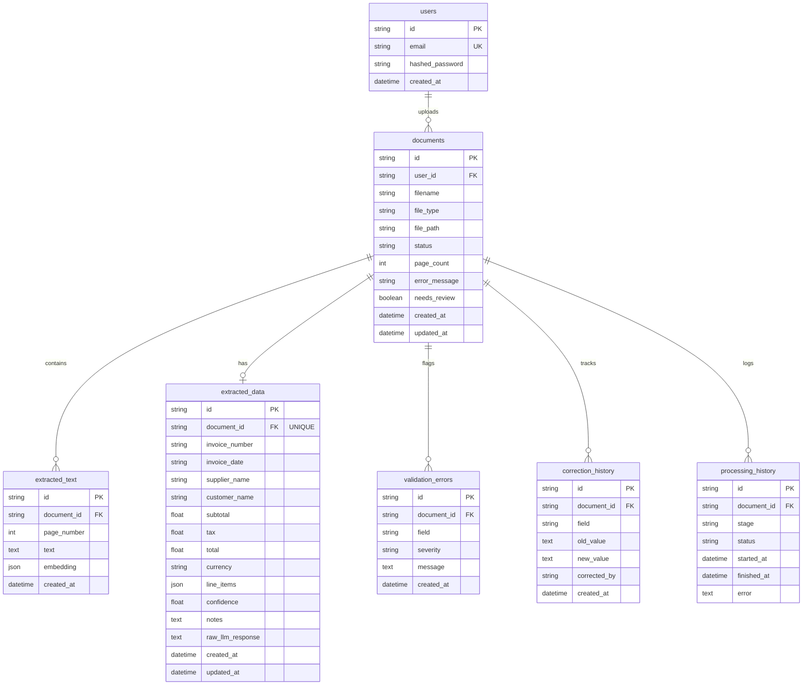

# Database Schema & Entity Relationships

## 1. Entity-Relationship Diagram

---

## 2. Table Specifications

### 2.1 `users`
Stores user credentials for JWT authentication.
- `id` (VARCHAR(36), PK): UUID.
- `email` (VARCHAR(255), UNIQUE, INDEX): Work email address.
- `hashed_password` (VARCHAR(255)): Bcrypt salted hash.
- `created_at` (TIMESTAMP WITH TIME ZONE): Account registration timestamp.

### 2.2 `documents`
Master record for every uploaded business document.
- `id` (VARCHAR(36), PK): UUID.
- `user_id` (VARCHAR(36), FK -> users.id, NULLABLE): Uploading user.
- `filename` (VARCHAR(255)): Sanitized original file name.
- `file_type` (VARCHAR(50)): Normalized extension (`pdf`, `xlsx`, `csv`, `png`, `jpg`, `tiff`).
- `file_path` (VARCHAR(512)): Absolute or relative file path in storage.
- `status` (VARCHAR(50), INDEX): Processing lifecycle state (`queued`, `processing`, `completed`, `failed`).
- `page_count` (INTEGER): Total pages or workbook sheets.
- `error_message` (TEXT, NULLABLE): Diagnostic error detail on failure.
- `needs_review` (BOOLEAN, INDEX): Set to `true` if arithmetic or validation checks fail.
- `created_at`, `updated_at` (TIMESTAMP WITH TIME ZONE).

### 2.3 `extracted_text`
Per-page OCR and text extraction results.
- `id` (VARCHAR(36), PK): UUID.
- `document_id` (VARCHAR(36), FK -> documents.id): Cascade delete.
- `page_number` (INTEGER): Page index (1-indexed).
- `text` (TEXT): Full raw text extracted for the page.
- `embedding` (JSON): Float vector embedding (1536-dim) generated for semantic vector search.

### 2.4 `extracted_data`
Structured entity extraction schema matching financial accounting requirements.
- `id` (VARCHAR(36), PK): UUID.
- `document_id` (VARCHAR(36), FK -> documents.id, UNIQUE): One-to-one link.
- `invoice_number` (VARCHAR(100), INDEX): Extracted invoice identifier.
- `invoice_date` (VARCHAR(50), INDEX): Extracted date in ISO format.
- `supplier_name` (VARCHAR(255), INDEX): Vendor or supplier company name.
- `customer_name` (VARCHAR(255)): Recipient organization.
- `subtotal` (FLOAT): Pre-tax subtotal.
- `tax` (FLOAT): Extracted tax or VAT.
- `total` (FLOAT): Final invoice total.
- `currency` (VARCHAR(10)): Standard currency code (USD, EUR, GBP, etc.).
- `line_items` (JSON / JSONB): Itemized list of `{description, quantity, unit_price, amount}`.
- `confidence` (FLOAT): Model certainty score (0.0 to 1.0).
- `notes` (TEXT): Model remarks or audit annotations.

### 2.5 `validation_errors`
Discrepancy audit log produced by deterministic validation rules.
- `id` (VARCHAR(36), PK): UUID.
- `document_id` (VARCHAR(36), FK -> documents.id).
- `field` (VARCHAR(100)): Target field (`total`, `subtotal`, `line_items`, `invoice_number`).
- `severity` (VARCHAR(20)): `error` or `warning`.
- `message` (TEXT): Explanatory discrepancy description.

### 2.6 `correction_history`
Audit trail of manual corrections applied via the frontend dashboard.
- `id` (VARCHAR(36), PK): UUID.
- `document_id` (VARCHAR(36), FK -> documents.id).
- `field` (VARCHAR(100)): Modified field name.
- `old_value` (TEXT): Value before modification.
- `new_value` (TEXT): Modified value.
- `corrected_by` (VARCHAR(36)): User ID or reviewer identifier.
- `created_at` (TIMESTAMP WITH TIME ZONE).

### 2.7 `processing_history`
Pipeline execution timing and observability.
- `id` (VARCHAR(36), PK): UUID.
- `document_id` (VARCHAR(36), FK -> documents.id).
- `stage` (VARCHAR(100)): `text_extraction`, `ai_extraction`, `validation`.
- `status` (VARCHAR(50)): `started`, `completed`, `failed`.
- `started_at`, `finished_at` (TIMESTAMP WITH TIME ZONE).
- `error` (TEXT, NULLABLE): Captured exception trace.
